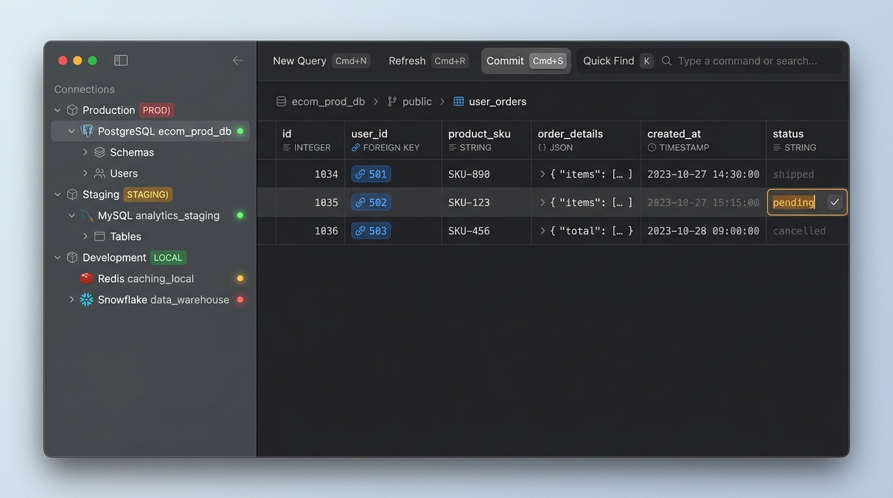
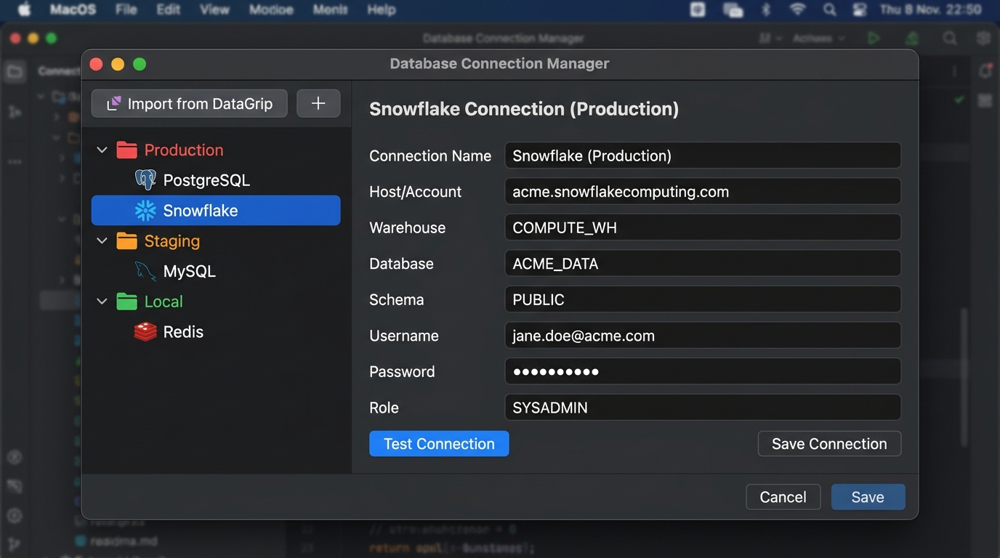
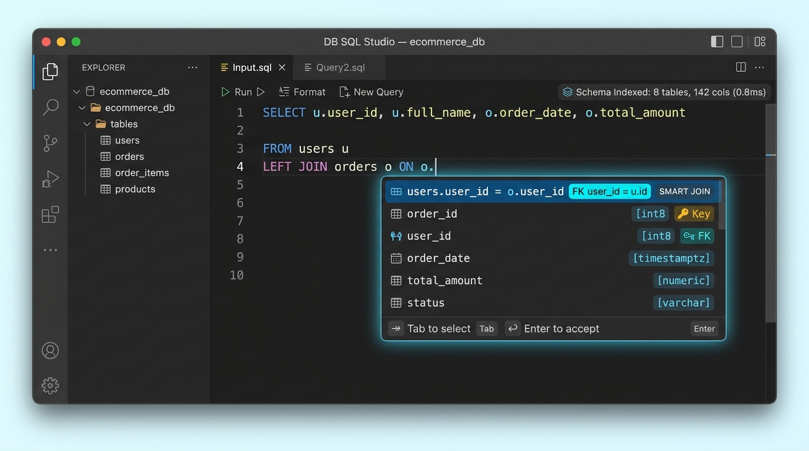
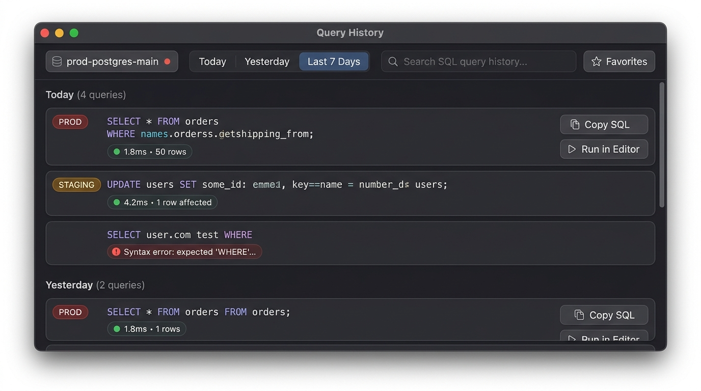
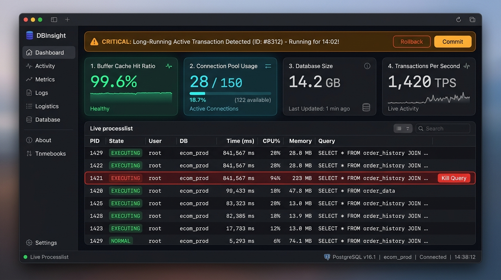

<p align="center">
  
</p>

<h1 align="center">db-nerd 🤓 🗄️</h1>

<p align="center">
  <strong>The fast, lightweight, native-feel database studio for developers who care about milliseconds.</strong>
</p>

<p align="center">
  
  
  
  
  
</p>

---

## 📸 Preview

<p align="center">
  
</p>

---

## ⚡ Why db-nerd?

Most database management tools force you into an agonizing trade-off:
* **The Bloat Trapped:** Heavy Java-based clients (JVM) consume 1.5GB–3GB of RAM, take 10 seconds to cold start, and drop frames due to garbage collection freezes.
* **The Web-Wrap Lag:** Generic Electron wrappers bundle hundreds of megabytes of Chromium, eating up battery on your MacBook.

**db-nerd** is built from scratch with **Tauri v2 + Rust Core + HTML5 Canvas** to deliver an uncompromisingly fast, native-feel studio that idles at **~50MB RAM** and opens in **under 0.4 seconds**.

```
┌────────────────────────────────────────────────────────────────────────┐
│                        PERFORMANCE BENCHMARK                           │
├──────────────────────┬─────────────┬─────────────┬─────────────────────┤
│ Metric               │ Typical JVM │ Electron    │ db-nerd 🤓          │
├──────────────────────┼─────────────┼─────────────┼─────────────────────┤
│ 📦 Installer Size    │ ~1,200 MB   │ ~180 MB     │ 🟢 ~20 MB (.dmg)    │
│ ⏱ Cold Start Time    │ 5 – 10s     │ 2 – 4s      │ 🟢 < 0.4s           │
│ 🧠 Idle RAM Usage    │ 1.5 – 3 GB  │ 350 – 600MB │ 🟢 ~45 – 65 MB      │
│ ⚡ Data Grid FPS     │ 30 – 60 FPS │ 45 – 60 FPS │ 🟢 120 FPS (Canvas) │
│ 🔋 Battery Drain     │ High        │ Moderate    │ 🟢 Minimal (Rust)   │
└──────────────────────┴─────────────┴─────────────┴─────────────────────┘
```

---

## ✨ Features

### 1. 120 FPS Virtualized Canvas Data Grid
Say goodbye to DOM lag. db-nerd renders millions of rows using hardware-accelerated Canvas with in-place cell editing, Foreign Key navigation pills (`🔗 501 (Alex Turner)`), inline JSON inspectors, and dirty state tracking with atomic commits.

### 2. Multi-Engine Connection Manager with Nested Groups
Organize databases into hierarchical folders with custom color-coded environment tags:
* 🔴 **Production:** Protected by **Safe Mode** (requires confirmation before executing destructive `UPDATE`/`DELETE`/`DROP` statements).
* 🟡 **Staging:** Fast QA access.
* 🟢 **Local Development:** Zero confirmation for lightning-fast prototyping.

<p align="center">
  
</p>

Supported MVP engines:
* 🐘 **PostgreSQL** (12–16+) with SSL and Unix sockets
* 🐬 **MySQL** (5.7, 8.0 & MariaDB)
* 🟥 **Redis** (Key-Value tree browser, live TTL countdown, hash/list/set editors)
* ❄️ **Snowflake** (Cloud Data Warehouse with Virtual Warehouse controls)
* 🔒 **SSH Bastion Tunneling** (Password, Private Keys, or `ssh-agent`)

### 3. SQL Studio with In-Memory Schema Indexing (< 0.8ms Autocomplete)
* Pre-indexes tables and columns into a **Radix Trie** on connection for sub-millisecond autocompletion.
* **Smart JOIN Assistance:** Analyzes Foreign Key dependency graphs to automatically propose `ON o.user_id = u.id` clauses.
* **On-the-fly Auto-Capitalize:** Automatically formats SQL keywords (`select` ➔ `SELECT`, `from` ➔ `FROM`).

<p align="center">
  
</p>

### 4. Query History & Audit Log
* Chronological history grouped by date (Today, Yesterday, Last 7 Days).
* Filterable per connection with **SQLite FTS5 full-text search**.
* 1-click **Copy SQL** and **Run in Editor**.

<p align="center">
  
</p>

### 5. Instance Observability & Activity Monitor
* Real-time **Processlist** (`pg_stat_activity` / `SHOW PROCESSLIST`).
* **1-Click "Kill Query"** button to terminate runaway, hanging queries instantly.
* Monitor **Buffer Cache Hit Ratio** (target > 99%), Connection Pool saturation, and **Table Bloat / Dead Tuples**.

<p align="center">
  
</p>

---

## 🚀 Quickstart

### 1. Start Local Test Databases
Spin up isolated PostgreSQL, MySQL, and Redis containers on `localhost`:
```bash
docker compose up -d
```

### 2. Install Dependencies
```bash
pnpm install
```

### 3. Run in Desktop Development Mode (Hot-Reload)
```bash
pnpm tauri dev
```

### 4. Build Native macOS `.dmg` Installer
```bash
# Apple Silicon (M1/M2/M3/M4):
pnpm tauri build

# Universal Binary (Intel + Apple Silicon):
pnpm tauri build --target universal-apple-darwin
```

---

## 📚 Documentation

* 📐 [Architecture Blueprint](docs/ARCHITECTURE.md) — Technical deep-dive into Tauri v2, Rust IPC, and Canvas virtualization.
* 🔌 [Database Drivers Guide](docs/DRIVERS.md) — Multi-engine configurations, SSH tunneling, and Safe Mode.
* 🛠️ [Development & Testing](docs/DEVELOPMENT.md) — Development loop, Docker Compose, and automated testing.
* 🤝 [Contributing Guidelines](docs/CONTRIBUTING.md) — PR workflow, coding conventions, and performance standards.

---

## 📄 License

Distributed under the **MIT License**. Created with 💖 for developers by Khoa Nguyen and the `db-nerd` community.
